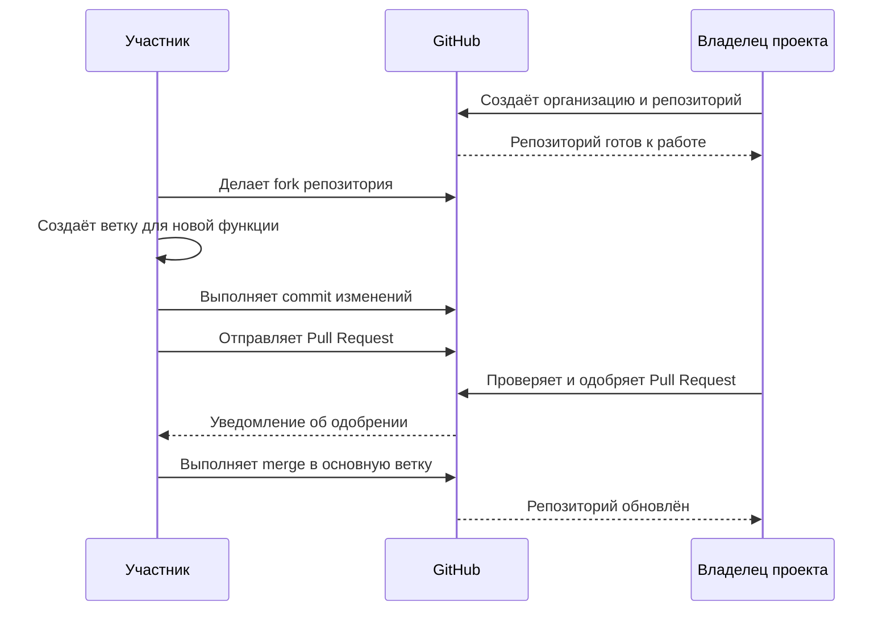

# Лабораторная работа №1

## Дисциплина
Технология разработки программного обеспечения

## Тема
Создание организации и проекта на GitHub

## Цель
Изучить основные возможности GitHub для организации совместной разработки программного обеспечения.

## Описание проекта
Этот репозиторий создан в рамках лабораторной работы №1. В ходе выполнения были выполнены следующие шаги:

1. Создан аккаунт GitHub.
2. Создана организация GitHub.
3. Создан репозиторий проекта.
4. Настроен профиль пользователя.
5. Добавлены участники в проект.
6. Создана документация проекта.
7. Инициализирован репозиторий с исходным кодом.

## Используемые технологии
- Git
- GitHub
- Markdown

## Автор
**Студент:** Май Ань Куан  
**Группа:** БФМО-02-26

## Схема процесса совместной работы на GitHub

Ниже приведена диаграмма последовательности (sequence diagram), показывающая взаимодействие участников при совместной разработке проекта на GitHub.

Схема иллюстрирует основные шаги взаимодействия между участником, владельцем проекта и GitHub в процессе совместной разработки программного обеспечения.
